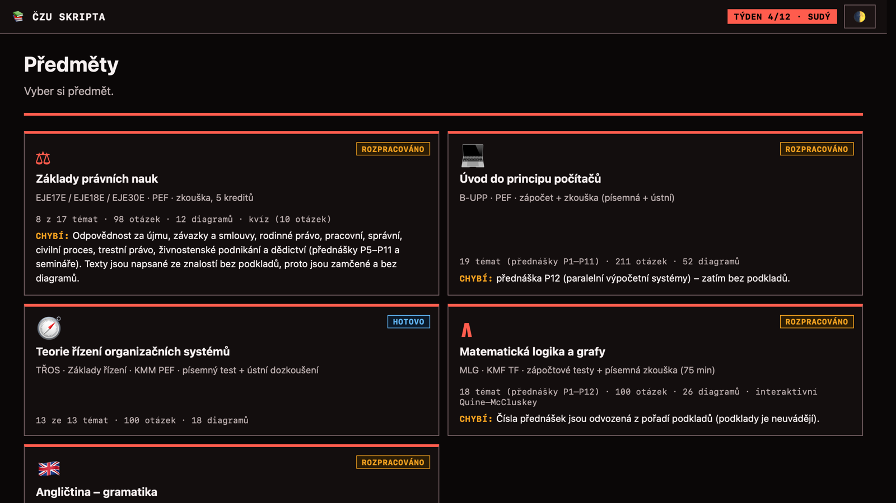
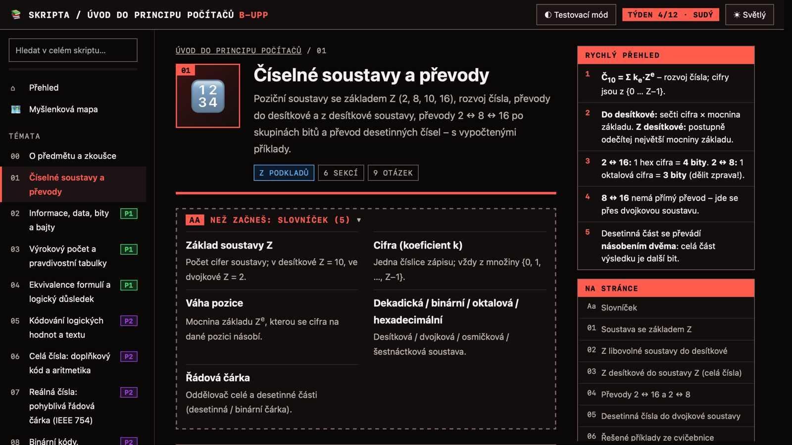
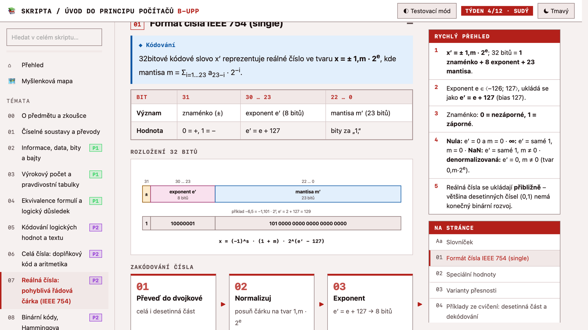
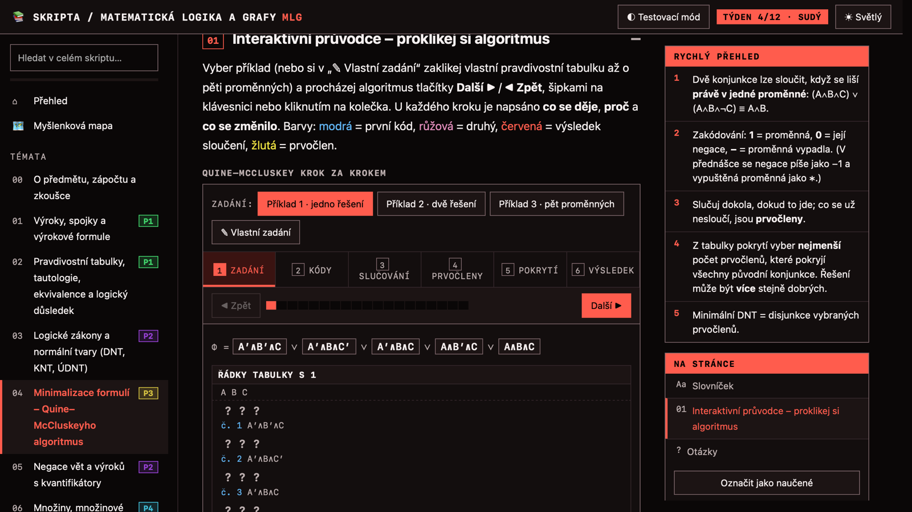
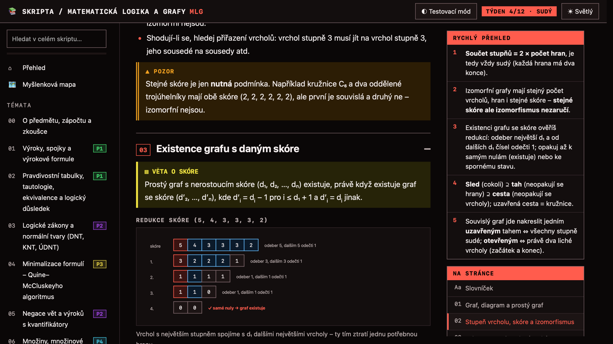
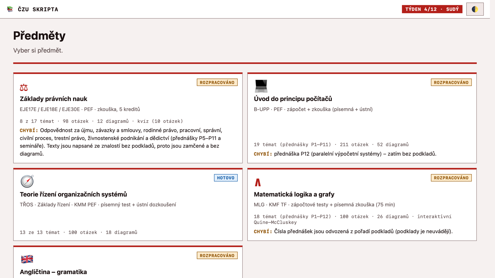

<div align="center">


# 📚 ČZU Skripta

**Study scripts for the Czech University of Life Sciences (ČZU / PEF) — worked examples, SVG diagrams, flashcards and mind maps.**

*Skripta pro přípravu na zkoušky · česky · bez build kroku · bez závislostí*


<br>



</div>

---

## ✨ What is this?

A static website that turns lecture slides into structured, searchable study material.
Every topic has a glossary, a quick-reference sidebar, calculated examples, common mistakes and Q&A flashcards.
Open `index.html` and start studying. There is nothing to install.

| | |
|---|---|
| 🧮 **Worked examples** | Numbers are calculated and checked by script, not guessed. |
| 🖼 **SVG diagrams** | 139 hand-built diagrams: IEEE 754 layout, graph reductions, automata, set relations and more. |
| 🗺 **Mind maps** | Zoomable, pinch-to-zoom maps per subject. Terms are generated from the topics. |
| 🃏 **Flashcards & quizzes** | Questions shuffle and repeat until you've memorised them. |
| 🎛 **Interactive widgets** | For example Quine–McCluskey, step by step. |
| ◐ **Test mode** | Hides definitions and paragraphs until you click them (active recall). |
| 🔎 **Full-text search** | Across the whole subject. |
| 🌗 **Dark / light theme** | Remembered in `localStorage`. |

## 🎓 Subjects

| | Subject | Code | Content |
|:-:|---|---|---|
| 💻 | **Úvod do principu počítačů** | B-UPP | 19 topics · 211 questions · 52 diagrams |
| ⚖️ | **Základy právních nauk** | EJE17E | 8 of 17 topics · 98 questions · 12 diagrams · quiz |
| 🧭 | **Teorie řízení organizačních systémů** | TŘOS | 13 of 13 topics · 100 questions · 18 diagrams · ✅ done |
| ∧ | **Matematická logika a grafy** | MLG | 18 topics · 100 questions · 26 diagrams · interactive Quine–McCluskey |
| 🇬🇧 | **Angličtina – gramatika** | Lifestyle Intermediate | 25 topics · 146 questions · 31 diagrams · mind map |

> Topics written without source material are marked `src: 'doplneno'` and stay **locked** in the UI.
> Only content backed by the supplied materials is shown.

## 🖼 Gallery

<table>
<tr>
<td width="50%"><br><sub><b>Topic page</b>: glossary, quick reference and table of contents on the right.</sub></td>
<td width="50%"><br><sub><b>Diagrams</b>: IEEE 754 bit layout with a worked example (light theme).</sub></td>
</tr>
<tr>
<td width="50%"><br><sub><b>Interactive widget</b>: Quine–McCluskey, step by step.</sub></td>
<td width="50%"><br><sub><b>Graph theory</b>: degree-sequence reduction with a warning box.</sub></td>
</tr>
</table>

<details>
<summary>☀️ Light theme</summary>
<br>

</details>

## 🚀 Quick start

```bash
git clone git@github.com:RealAnthony0001/czu-skripta.git
cd czu-skripta
python3 -m http.server      # or just open index.html
```

Then go to <http://localhost:8000>.

## 🗂 Project layout

```
index.html                 subject picker (cards)
assets/
  app.js                   shared engine: topics, search, flashcards, quizzes
  dg.js                    SVG helpers for diagrams (DG)
  map.js                   mind-map engine
  style.css                dark/light theme via CSS variables
<subject>/
  index.html               subject page: window.SUBJECT + topic <script>s
  topics/NN-*.js           one topic = one file, calls registerTopic({...})
  diagrams.js              SVG diagrams for the subject
  map.js                   mind-map skeleton
tools/shot.swift           HTML → PNG (WebKit), used to check diagrams
docs/img/                  screenshots for this README
```

## ✍️ Adding content

A topic is a single JS file:

```js
registerTopic({
  id: 'ciselne-soustavy', order: 1, icon: '🔢',
  title: 'Číselné soustavy a převody',
  src: 'podklady',                       // 'doplneno' = no source material → locked
  vocab:    [{ w: 'pojem', x: 'vysvětlení' }],
  key:      ['<b>…</b> …'],
  sections: [{ title: '…', blocks: [{ t: 'def', term: '…', x: '…' }] }],
  mistakes: ['…'],
  qa:       [{ q: 'otázka', a: 'odpověď' }]
});
```

Block types include `def`, `law`, `tip`, `warn`, `ex`, `table`, `flow`, `tree`, `timeline`, `versus`, `svg` and `widget`.
The full reference is in [`CLAUDE.md`](CLAUDE.md).

**Verify your changes:**

```bash
node --check assets/app.js
# load the subject's topics in node:vm with a stub registerTopic to catch syntax errors

# render a diagram page to PNG (WebKit, macOS)
swiftc -O -o /tmp/shot tools/shot.swift
/tmp/shot "$PWD" diagram.html diagram.png
SHOT_DELAY=2 /tmp/shot "$PWD" page.html page.png   # wait longer for animated pages
```

## 📌 Principles

- **Facts only from the supplied materials.** If a slide is wrong, the script gives the correct version and a `warn` explaining the difference.
- **Every subject has diagrams** from the start.
- **No build step, no dependencies**, so it works from `file://`.

---

<div align="center">
<sub>Created in <a href="https://t3.codes">T3 Code</a></sub>
</div>
